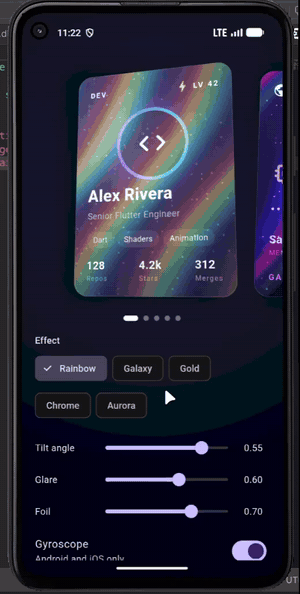
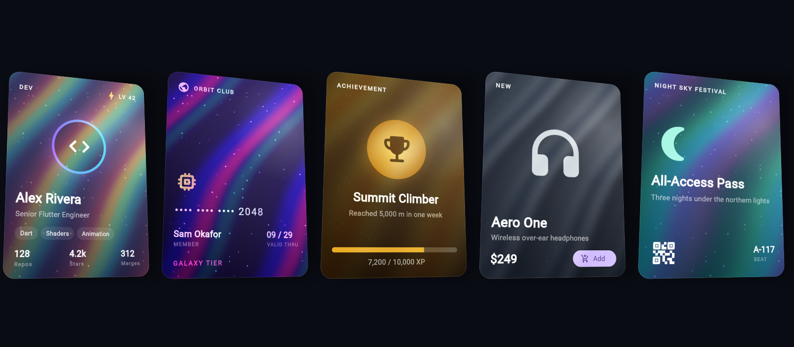

# holo_card

Wrap any widget in a 3D collectible-style card that tilts with your pointer or
gyroscope, with a moving glare and a holographic foil that shifts as it turns,
like a foil trading card catching the light. Pure Flutter, no network, no
image assets.



[Watch the full demo video](https://github.com/HammasT1/holo_card/raw/main/media/demo.mp4)



**Live web demo:** https://hammast1.github.io/holo_card/

## Quick start

```yaml
dependencies:
  holo_card: ^0.1.0
```

```dart
import 'package:holo_card/holo_card.dart';

HoloCard(effect: HoloEffect.rainbow, child: MyCardContent())
```

## Features

* 3D tilt with perspective, driven by mouse hover, touch drag or the device gyroscope.
* Glare: a radial highlight that follows the light.
* Foil: a fragment-shader holographic effect (diagonal iridescent bands plus
  sparkle) whose phase follows the tilt, clipped to your card's corners.
* Spring return to rest when interaction ends, and an optional idle sway.
* Five presets plus a fully custom palette.
* Your child is never rebuilt while the card moves, and taps on buttons inside it keep working.
* Automatic gradient fallback if shaders are unavailable. It never crashes.
* Honors reduced motion. Programmatic control through `HoloCardController`.

## Effects

| Effect | Look |
| --- | --- |
| `HoloEffect.rainbow` | Full-spectrum rainbow foil |
| `HoloEffect.galaxy` | Deep blue and purple with bright pink and cyan flecks |
| `HoloEffect.gold` | Warm metallic gold |
| `HoloEffect.chrome` | Cool brushed steel |
| `HoloEffect.aurora` | Green, teal and violet ribbons |
| `HoloEffect.custom(...)` | Your own 2–6 colors, band density, shimmer speed, sparkle and blend mode |

```dart
HoloCard(
  effect: HoloEffect.custom(
    colors: [Color(0xFFFF6B6B), Color(0xFFFFD93D), Color(0xFF6BCB77)],
    bandDensity: 4,
    shimmerSpeed: 1.5,
  ),
  child: MyCardContent(),
)
```

## Parameters

### `HoloCard`

| Parameter | Default | Description |
| --- | --- | --- |
| `child` | required | The card content |
| `effect` | `HoloEffect.rainbow` | The foil look |
| `maxTiltAngle` | `0.35` | Rotation in radians at full tilt |
| `perspective` | `0.0012` | Perspective strength (matrix `[3][2]`) |
| `borderRadius` | `BorderRadius.circular(20)` | Clips the effect layers and shapes the shadow; match your child's radius |
| `glareIntensity` | `0.6` | Glare strength, 0–1 |
| `foilIntensity` | `0.7` | Foil strength, 0–1 |
| `shadow` | `true` | Drop shadow that shifts with the tilt |
| `enableGyroscope` | `true` | Tilt with the gyroscope (Android and iOS only) |
| `enablePointer` | `true` | Hover (mouse) and drag (touch) |
| `idleAnimation` | `true` | Gentle sway while untouched |
| `controller` | `null` | A `HoloCardController` |
| `onTiltChanged` | `null` | Called with the normalized tilt (each axis `-1..1`). Can fire every frame |

### `HoloCardController`

A `ChangeNotifier`; call `dispose()` when done. Tilt values are normalized to `-1..1`.

| Member | Description |
| --- | --- |
| `tiltTo(Offset)` | Spring to a tilt and hold it (pauses idle) until `reset()` or user input |
| `reset()` | Clear the held tilt and return to rest |
| `startIdle()` / `stopIdle()` | Force the idle animation on or off, overriding `idleAnimation` |
| `targetTilt`, `idleOverride` | Current commanded state |

## Platform support

| Platform | Pointer / touch | Gyroscope | Foil |
| --- | --- | --- | --- |
| Android, iOS | ✅ | ✅ | Shader |
| Web | ✅ | ❌ (not used) | Shader (CanvasKit / skwasm) |
| Windows, macOS, Linux | ✅ | ❌ | Shader |

* **The gyroscope is mobile only.** It is ignored on desktop and web, and on
  mobile devices without the sensor. The card then simply uses touch.
* The gyroscope is integrated into a relative tilt that settles when the device
  is held still, so the card does not stay tilted forever.
* **Shader notes.** The foil is a fragment shader (`shaders/holo_foil.frag`,
  loaded once and cached). It was verified to compile and render on web
  (CanvasKit). If it cannot load, a tilt-driven gradient is used instead,
  with a similar but simpler look. Blending with your content relies on the
  foil being composited over it, so wrapping the card in something that
  isolates it onto its own offscreen layer will change how the blend looks.
* Tested on Flutter 3.47. Declared minimum is Flutter 3.27 / Dart 3.6.
  Gyroscope axis direction has not been verified on physical hardware.

## Accessibility

Your child's semantics are untouched; the effect layers add none and ignore
pointer events. With reduced motion on (`MediaQuery.disableAnimations`), the
idle animation and gyroscope are off, the foil is calmer, and the return spring
does not overshoot.

## Performance tips

* The child is repainted from a cached layer, not rebuilt. Keep it a plain
  widget subtree and avoid putting your own constantly-animating widgets inside.
* Many cards on screen at once (long lists) each run a ticker only while moving;
  set `idleAnimation: false` on lists so resting cards cost nothing.
* Lower `foilIntensity` or set `glareIntensity: 0` to cut work on low-end devices.
* `shadow: false` removes a blur layer.
* Keep `onTiltChanged` cheap, since it can be called every frame.

## Example

See [`example/`](example/) for a gallery with live controls.

## License

MIT, see [LICENSE](LICENSE).
